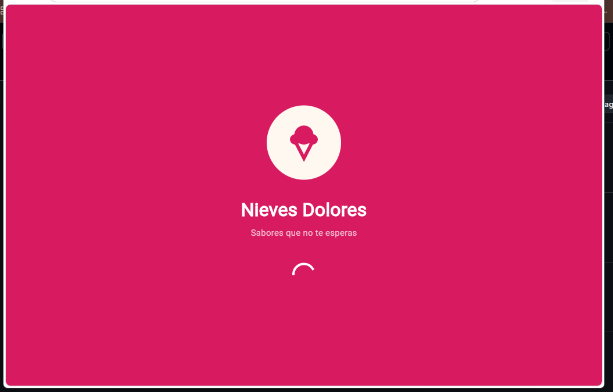
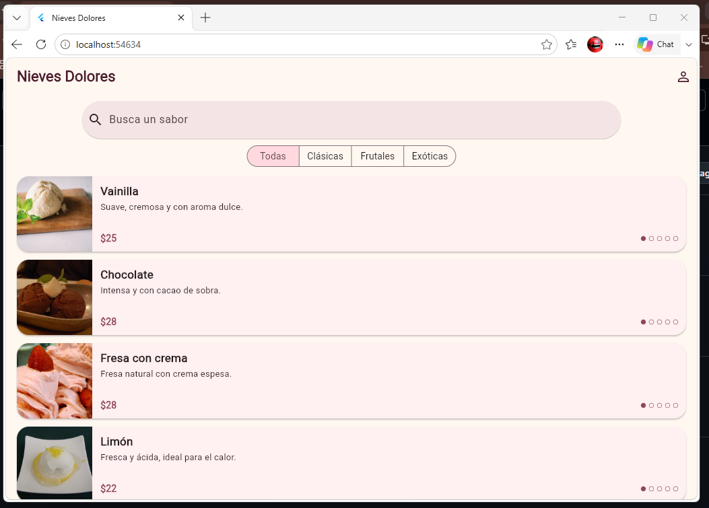
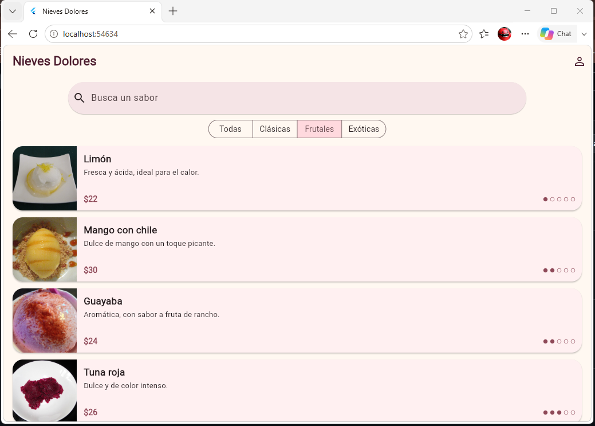
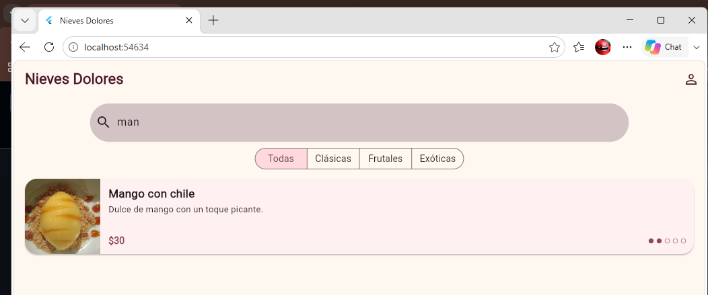
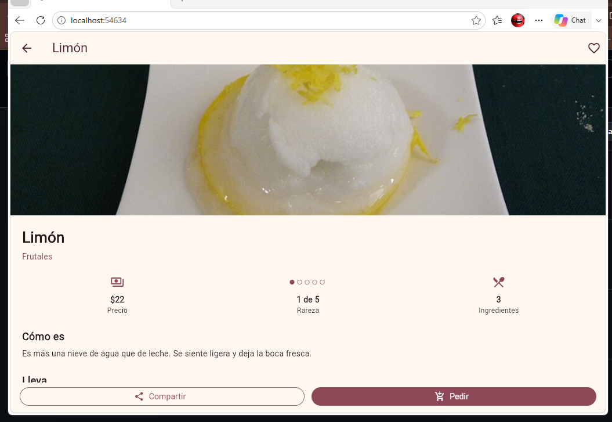
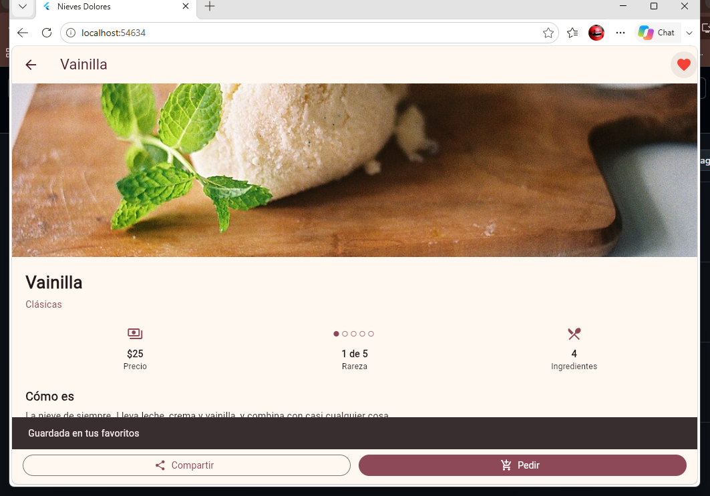
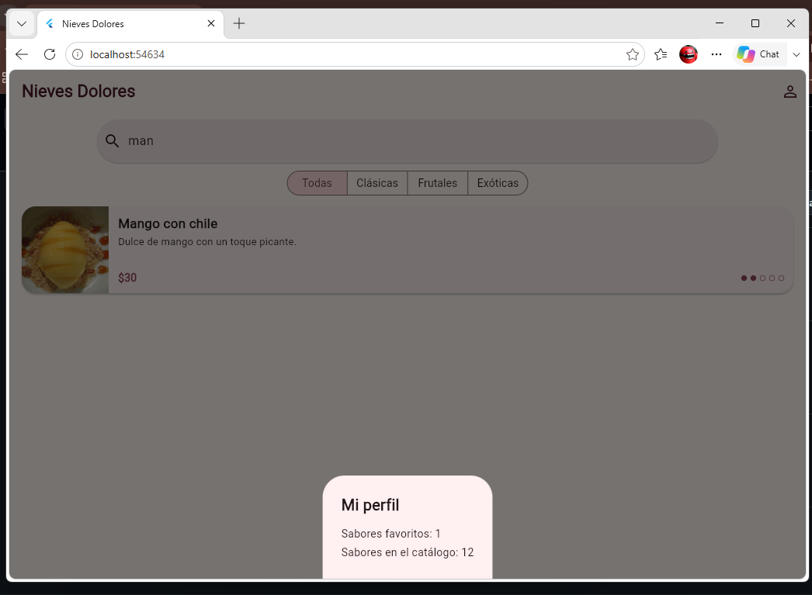

# Práctica 7 · Nieves Dolores

App móvil en Flutter: catálogo de nieves de sabores de Dolores Hidalgo. Los datos son de ejemplo (12 sabores).

- **Alumno:** Oscar Manuel Ayala Ortiz
- **Grupo:** GTID244 · **Núm. de control:** 1225100784
- **Materia:** Desarrollo de Aplicaciones Móviles (UTNG)

## Pantallas

1. **Splash:** logo animado, indicador de carga y paso automático a los 3 segundos.
2. **Inicio:** barra de búsqueda, filtros por categoría (Todas, Clásicas, Frutales, Exóticas) y lista de sabores en tarjetas.
3. **Detalle:** imagen grande, precio, rareza, descripción, ingredientes y botones de favorito, compartir y pedir.
4. **Mi perfil:** panel con el número de sabores favoritos y los del catálogo.

## Estructura

```
lib/
├── models/sabor.dart              Clase Sabor
├── data/sabores.dart              Lista de sabores de ejemplo
├── screens/
│   ├── splash_screen.dart
│   ├── home_screen.dart
│   └── detalle_screen.dart
├── widgets/
│   ├── sabor_card.dart            Tarjeta de la lista
│   ├── sabor_imagen.dart          Imagen con respaldo si falta la foto
│   └── rareza_puntos.dart         Puntos de rareza
└── main.dart
assets/images/                     Fotos de los sabores
```

## Cómo ejecutarla

```
flutter pub get
flutter run -d chrome
```

## Evidencia de funcionamiento

| Splash | Inicio | Filtro Frutales |
|---|---|---|
|  |  |  |

| Búsqueda ("man") | Detalle de Limón | Favorito guardado |
|---|---|---|
|  |  |  |

| Mi perfil |
|---|
|  |
